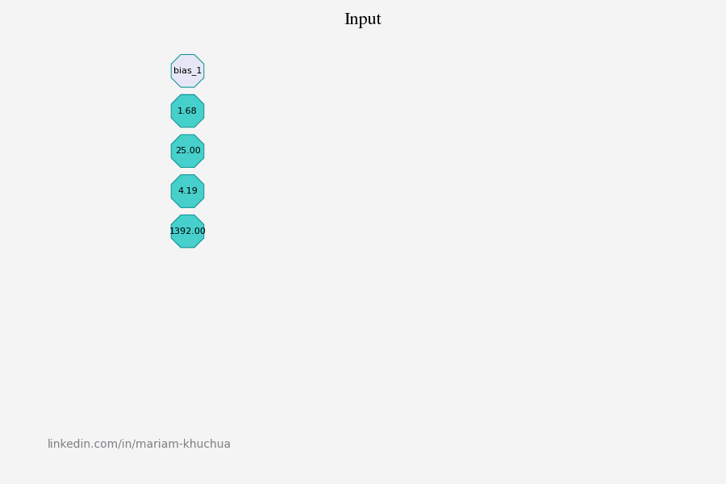

# Explainable AI Visualizations


## Overview

Explainable AI Visualizations is a project that aims to provide visualizations to enhance the interpretability and understanding of AI models. The goal is to make complex models more transparent and explainable to both technical and non-technical users.

## Features

### Original GIF Visualization

Generate GIFs from fully connected neural network models, like this one



### Modern XAI Frameworks Comparison
A new comprehensive Jupyter notebook that prototypes and compares five modern XAI frameworks: LIME, SHAP, ELI5, InterpretML, and Captum. This notebook provides a practical guide to understanding and applying these powerful tools.

Check it out here: [XAI Frameworks Comparison Notebook](notebooks/xai_frameworks_comparison.ipynb)

### Framework Comparison Overview

| Framework   | Pros                                                                                                 | Cons                                                                                      | Best Use-Case                                                                                             |
|-------------|------------------------------------------------------------------------------------------------------|-------------------------------------------------------------------------------------------|-----------------------------------------------------------------------------------------------------------|
| **LIME**    | - Very intuitive and easy to understand.<br>- Truly model-agnostic.<br>- Good for explaining individual predictions. | - Can be slow.<br>- Explanations can be unstable.<br>- Primarily for local explanations.          | Explaining a single prediction to a non-technical audience; building trust in individual model outputs. |
| **SHAP**    | - Strong theoretical foundation (Shapley values).<br>- Provides both local and global explanations.<br>- Consistent and accurate. | - Can be computationally expensive, especially with non-tree models.<br>- Can be complex to interpret. | When you need robust, consistent explanations for both individual predictions and overall model behavior. |
| **ELI5**    | - Very easy to use.<br>- Great for scikit-learn models.<br>- Provides clear feature importances.         | - Limited support for models outside of the scikit-learn ecosystem.<br>- Less visual than others. | Quickly debugging and understanding the feature importances of scikit-learn models.                     |
| **InterpretML** | - Comprehensive suite of tools.<br>- Interactive dashboard for exploration.<br>- Includes interpretable "glassbox" models. | - Can be more complex to set up.<br>- Dashboard can be overwhelming.                       | When you need a full suite of interpretability tools, including an interactive dashboard for deep dives.  |
| **Captum**  | - Built specifically for PyTorch.<br>- Wide range of attribution algorithms.<br>- Very flexible and powerful. | - Steeper learning curve.<br>- Primarily for deep learning models.<br>- Requires more code to use. | Explaining the behavior of complex PyTorch models, especially in research and development settings.      |

## Getting Started

To get started with the project, follow these steps:

#### 1. Clone the repository to your local machine

```git clone https://github.com/mariamkhuchua/ai-explainable-visualizations.git```

#### 2. Create a Python virtial environment within the repository
```
virtualenv -p /usr/bin/python3.10 venv
source /venv/bin/activate
```
#### 3. Install required libraries
   
```pip install -r requirements.txt ```

#### 4. Check out the [Jupyter notebooks](../notebooks) folder
Run the notebook code as is or modify it for training and visualizing your own models.
